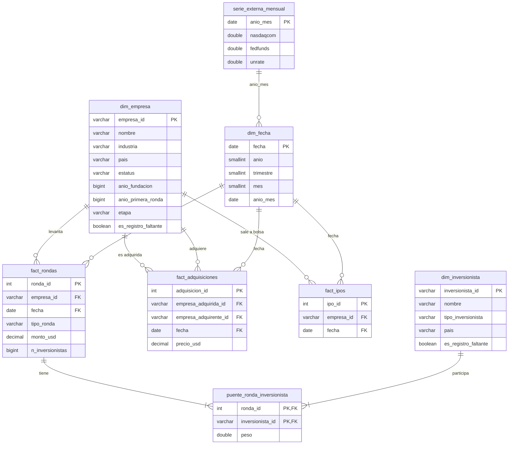

# Diagrama del modelo dimensional (esquema `marts`)

Granos: `fact_rondas` = una ronda · `fact_adquisiciones` = una adquisición ·
`fact_ipos` = una IPO · `puente_ronda_inversionista` = un par (ronda, inversionista) ·
`serie_externa_mensual` = un mes.
El monto solo vive en `fact_rondas`; el puente reparte con `peso`.
Detalle de columnas en `diccionario_modelo.md`.
